# Modelo de datos · SIGLA 2.0 (TOS)

Este documento es la **fuente de verdad del modelo de datos**. Crece con el producto: solo tiene diagrama y diccionario de las tablas que existen o que entran en el sprint en curso. Lo que viene después queda como decisiones guardadas (sección 7), sin diagrama, y se promueve al diccionario cuando su historia entra a un sprint.

**Alcance actual:** Sprint 1 (2026-11-02 a 2026-11-06) y Sprint 2 (H10, H07, H11, H12, H13, H21, H22, H23, H25, H26) · **Última revisión:** 2026-11-13 · **Estado:** aprobado por el usuario el 2026-11-04.

Base de partida: el ER del usuario (`SIGLA2.0.mwb`, 29 tablas), las migraciones del repo y el cuestionario de la tarea T18. Si el ER y este documento difieren, manda este documento.

## 1. Cómo se mantiene

1. Toda migración que cree o cambie una tabla actualiza este archivo **en el mismo PR**: diagrama, diccionario y estado de la tabla.
2. Al empezar un sprint, se mueven de la sección 7 al diccionario las tablas de las historias que entran, ajustadas a lo que diga su criterio de aceptación.
3. Si el código y este documento se contradicen, se avisa al usuario. No se decide en silencio.
4. Una tabla solo pasa a `en código` cuando su migración está en `main`.

### Estados de una tabla

| Estado | Significa |
| --- | --- |
| `framework` | La crea Laravel o un paquete; no se diseña aquí. |
| `en código` | Ya existe una migración en `main`. |
| `planeada (T##/H##)` | Entra en este sprint; la crea la tarea o historia indicada. |
| `siguiente` | Diseño decidido, pero es de un sprint posterior (sección 7). |
| `por decidir` | Falta una decisión del usuario (sección 8). |
| `futura` | Fuera del Product Goal actual. |

## 2. Convenciones (aplican a toda tabla nueva)

- **Nombres en inglés**, tablas en plural `snake_case`, modelos en singular. Valores guardados en inglés (`active`, `available`). Pantallas y mensajes en español.
- **Llaves:** `id()` (bigint sin signo) y `foreignId()`. El ER usaba `int`: no se respeta.
- **Marcas de tiempo:** `timestamps()` en todas las tablas. Las tablas puente puras pueden omitirlas.
- **Maestros que se desactivan:** `softDeletes()` (`deleted_at`), nunca una columna de estado. Un maestro desactivado sigue ocupando sus índices únicos: se **reactiva**, no se vuelve a crear.
- **Nulos:** `NOT NULL` por defecto. Solo es opcional lo que la historia dice que es opcional. El ER traía casi todo nulo: no se respeta.
- **Estados de proceso** (kit, dispositivo, certificación): columna `status` con un `enum` de PHP en inglés, no `softDeletes`.
- **Escrituras en varias tablas:** todo o nada, dentro de una transacción.
- **Compatibilidad:** las migraciones corren desde cero y funcionan en **MariaDB 10.6** (producción cPanel). Nunca se hace ingeniería directa del `.mwb` (su intercalación es de MySQL 8). La intercalación es la de `config/database.php` (`utf8mb4_unicode_ci`).
- **Zona horaria:** la app guarda en UTC (`config/app.php`). Lo que depende del calendario local se calcula en `America/Lima`.
- **Datos personales:** DNI, brevete y número de documento solo los ven los roles que los necesitan; nunca van en URLs ni en logs.
- **Excepción documentada:** `identities` es un catálogo fijo cargado por seeder, sin pantalla y sin `deleted_at`. `companies` tampoco lleva `deleted_at`: la única empresa se carga por seeder y se modifica en su pantalla (H27), sin crearse ni eliminarse.

## 3. Tablas del Sprint 1

| Tabla | Épica / tarea | Estado | Nombre en el ER |
| --- | --- | --- | --- |
| `users` | E1 · H04 (T15) y T19 | `en código` | `users` |
| `passkeys` | E1 · H01 | `en código` | (no estaba en el ER) |
| `identities` | E1 · T19 | `en código` | (nueva; catálogo SUNAT 06) |
| `companies` | E1 · T19 y H27 | `en código` | `company` |
| `branches` | E1 · T19 | `en código` | `branches` |
| `shipping_lines` | E8 · H09 | `en código` | `shipping_lines` |
| `providers` | E8 · H10 | `en código` | `providers` |
| `clients` | E8 · H31 | `en código` | `clients` (estaba como futura) |
| `security_device_types` | E2 · H06 | `en código` | `security_device_types` |
| `security_device_announcements` | E2 · H07 | `en código` | `security_device_types_announcement` |
| `security_device_lots` | E2 · H07 | `en código` | `security_device_lots` |
| `security_devices` | E2 · H07 | `en código` | `s_device_lots_units` |
| `security_device_lot_approvals` | E2 · H29 | `en código` | (nueva; bitácora de aprobaciones de la naviera) |
| `certification_sections` | E3 · H11 | `planeada (T35/H11)` | `certification_criteria_items` |
| `certification_section_security_device_type` | E3 · H12 | `planeada (T38/H12)` | (nueva; en el ER, la cantidad iba en `certification_criteria_items`) |
| `carriers` | E9 · H21 | `en código` | (no estaba en el ER) |
| `drivers` | E9 · H22 | `en código` | (no estaba en el ER) |
| `vehicle_bodies` | E9 · H23 | `en código` | (no estaba en el ER) |
| `carrier_driver` | E9 · H22 (T45) | `planeada (T45/H22)` | (no estaba en el ER) |
| `vehicles` | E9 · H23 | `en código` | (no estaba en el ER) |
| `container_types` | E4 · H13 | `planeada (T39/H13)` | `container_types` |
| `kit_types` | E4 · H13 | `planeada (T39/H13)` | `type_kits` |
| `kit_type_security_device_type` | E4 · H13 | `planeada (T39/H13)` | (nueva; el ER traía los ids sueltos) |
| `kits` | E4 · H14 | `en código` | `kits` |
| `kit_security_device_type` | E4 · H14 | `en código` | (nueva; copia de lo que lleva el tipo de kit) |
| `kit_security_device` | E4 · H14 | `en código` | `kits_device_units` |
| `workers` | E4 · H25 | `en código` | `workers` |
| `bulk_dispatches` | E4 · H30 | `en código` | `device_dispatches` |
| `bulk_dispatch_items` | E4 · H30 | `en código` | `device_dispatches_units` |
| `certifications` | E5 · H17 | `en código` | `security_certifications` |
| `certification_steps` | E5 · H18 | `en código` | (nueva; en el ER, las secciones de la certificación iban en `certification_criteria_items`) |
| `certification_step_security_device` | E5 · H18 | `en código` | (nueva) |
| `certification_photos` | E5 · H18 | `en código` | (nueva; cierra P3) |
| `certification_reopenings` | E5 · H19 | `en código` | (nueva; con `closed_at` y `closed_by` en `certifications`, cierra P4) |
| `password_reset_tokens`, `sessions` | E1 · H01/H03 | `framework` | — |
| `cache`, `cache_locks`, `jobs`, `job_batches`, `failed_jobs` | — | `framework` | — |

## 4. Diagramas

### 4.1 Usuarios, identidad, empresa y sucursales (E1)

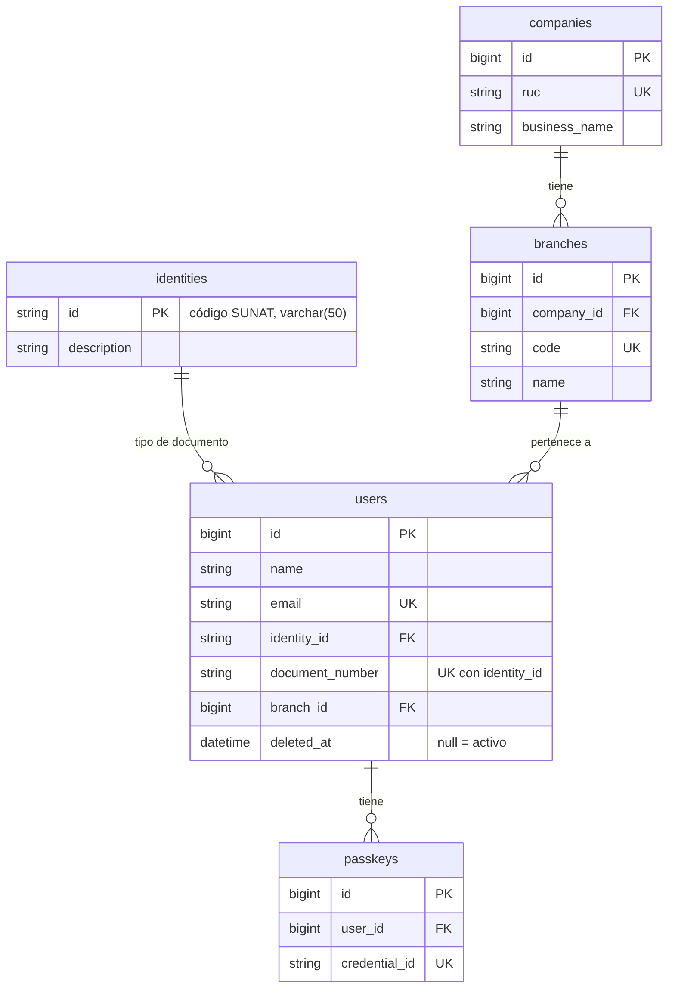

### 4.2 Maestros: navieras, proveedores, clientes y tipos de dispositivo (E8, E2)

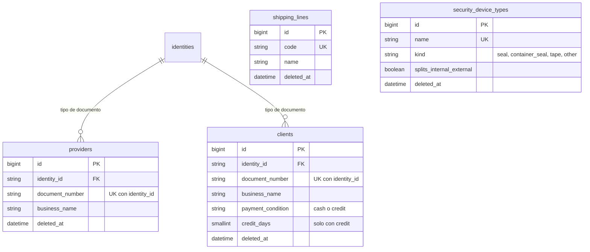

### 4.3 Lotes y dispositivos de seguridad (E2)

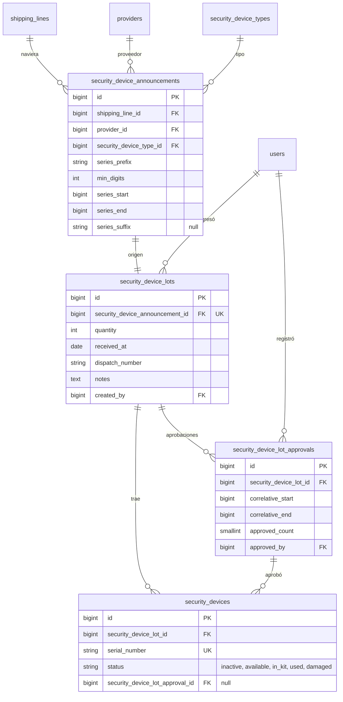

### 4.4 Secciones de certificación (E3)

Cada sección dice qué tipos de dispositivo lleva y cuántos de cada uno (H12). Puede no llevar ninguno: solo pide fotos. Las puertas no son un tipo de sección: son una sección externa más (decisión del usuario del 2026-11-12, cierra P1).

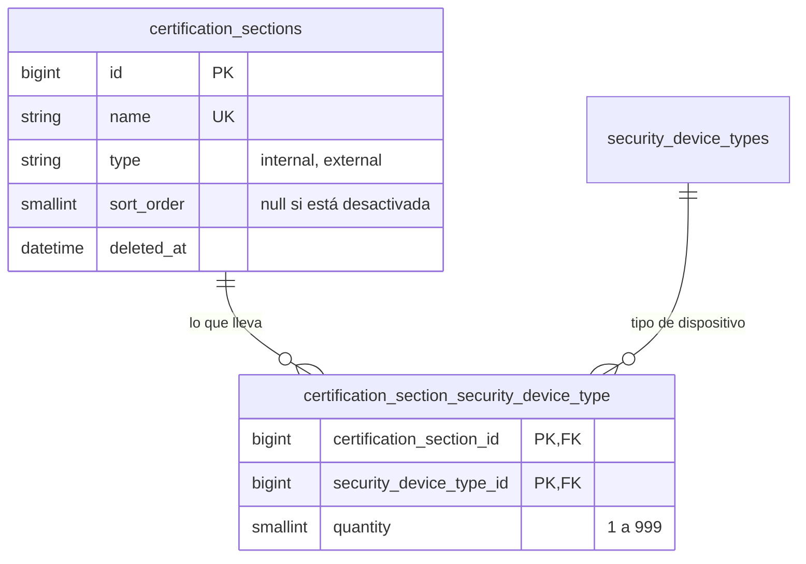

### 4.5 Transportistas, conductores y vehículos (E9)

Transportistas, conductores y vehículos son catálogos propios. Los conductores van por transportista con la tabla puente `carrier_driver` (T45): un conductor puede estar en varios y se desactiva en cada uno por separado. Los vehículos no se relacionan con los transportistas; la relación se guardará en cada certificación (H17). Cada vehículo tiene una carrocería del catálogo `vehicle_bodies`.

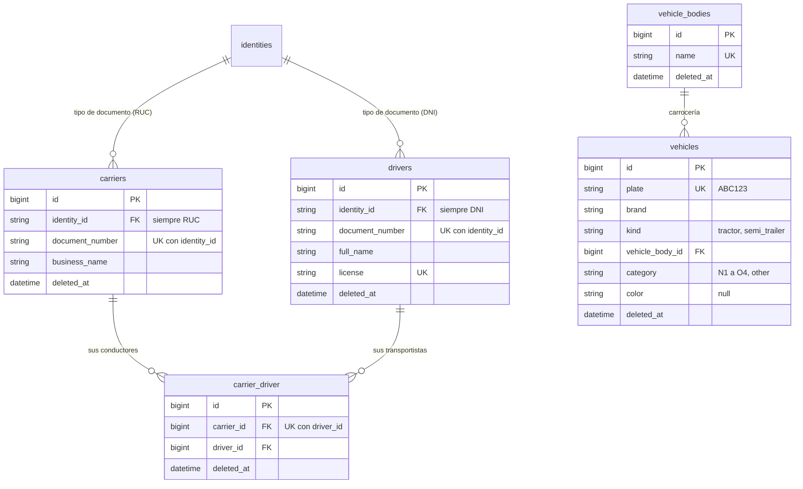

### 4.6 Tipos de kit (E4)

Cada tipo de kit es para un tipo de contenedor y dice cuántos dispositivos de cada tipo lleva. La tabla puente incluye los tipos de dispositivo desactivados: desactivar uno no se bloquea aunque un tipo de kit lo use, y el tipo de kit lo conserva hasta que lo quiten (decisión del usuario del 2026-11-12). Los tipos de contenedor no tienen pantalla.

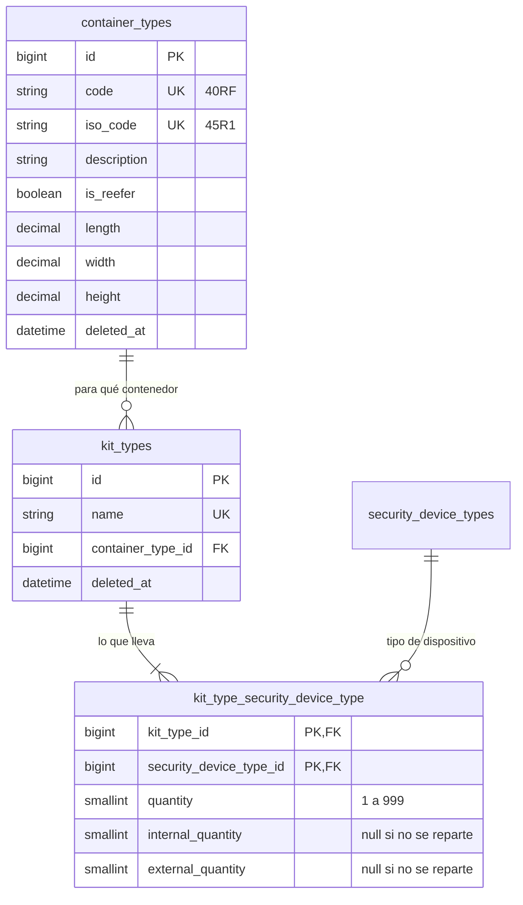

### 4.6b Kits (E4)

Bodega crea un kit con su funda, su tipo de kit y su naviera, y le escanea dispositivos (H14). Al crearlo se copia lo que lleva el tipo de kit, para que editar el tipo de kit no cambie los kits ya armados (H13, criterio 5). Cada dispositivo del kit guarda a qué lado va cuando su tipo se reparte entre la asignación interna y la externa, como la cinta de inspección (cambio del usuario del 2026-11-16).

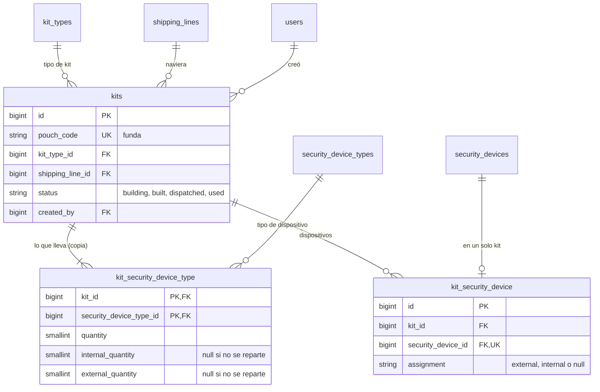

### 4.6c Despachos de kits (E4)

Bodega despacha uno o más kits Armados a un trabajador (H15). Quien entrega es el usuario que despacha (`created_by`). Cada kit queda en un solo despacho y pasa a Despachado. El trabajador que recibe solo queda registrado: no limita qué kits usa el inspector (cambio del usuario del 2026-11-17).

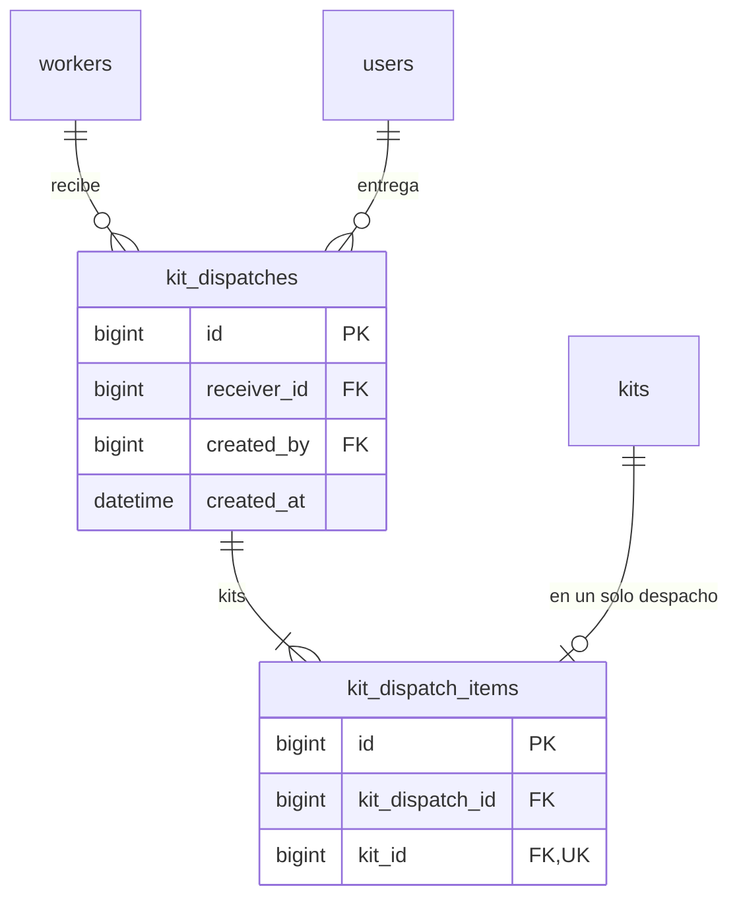

### 4.6d Despachos a granel (E4)

Bodega despacha dispositivos sueltos, sin kit, a un trabajador (H30). Con Venta van a un cliente; con Operación, a un kit ya despachado. Cada dispositivo queda en un solo despacho a granel y pasa a Despachado.

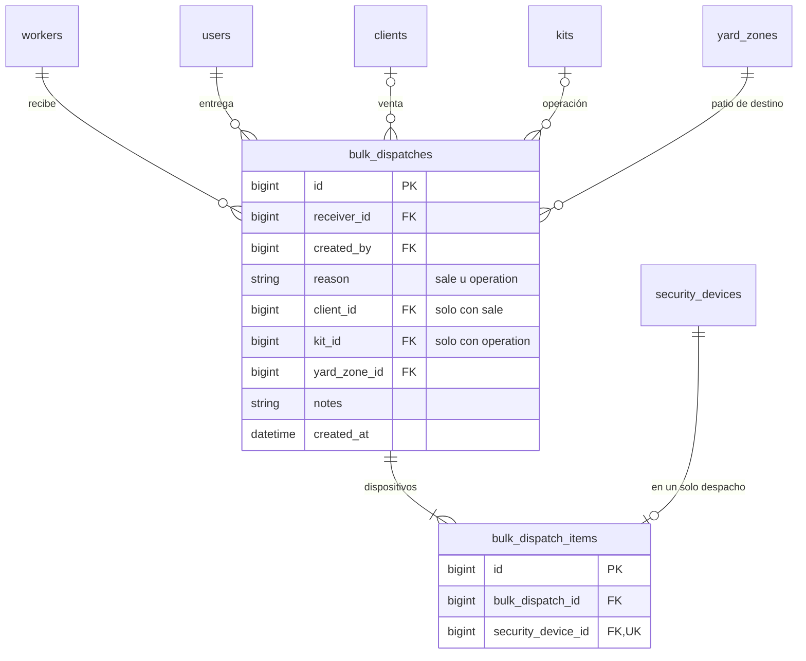

### 4.7 Trabajadores (E4)

Quienes reciben los kits (H15). Un trabajador es propio o de un proveedor. No tiene llave hacia `users`: el inspector se reconoce porque su usuario y su trabajador tienen el mismo tipo y número de documento (decisión del usuario del 2026-11-04).

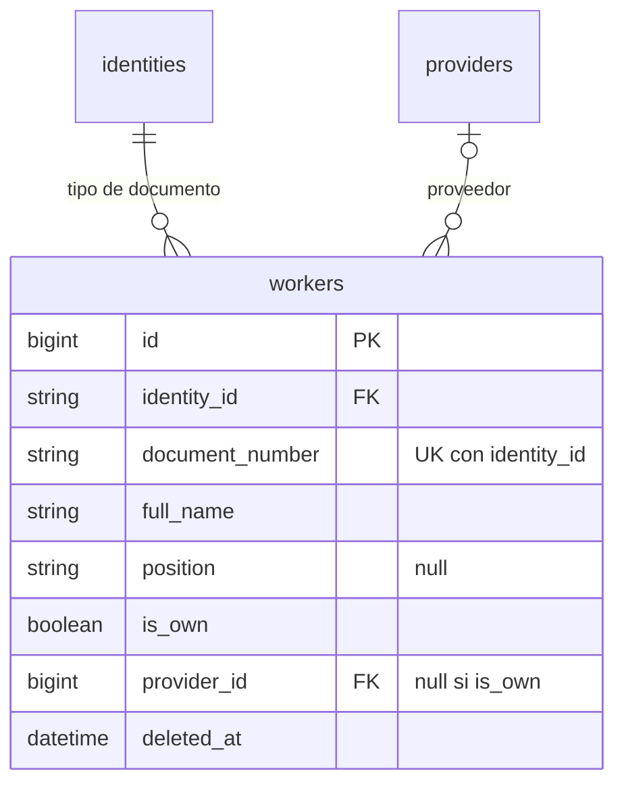

### 4.8 Zonas de patio (E4)

Zonas del patio de cada sucursal (H26). El inspector elige una al iniciar una certificación (H17). La capacidad es solo informativa: no se controla la ocupación (decisión del usuario del 2026-11-13).

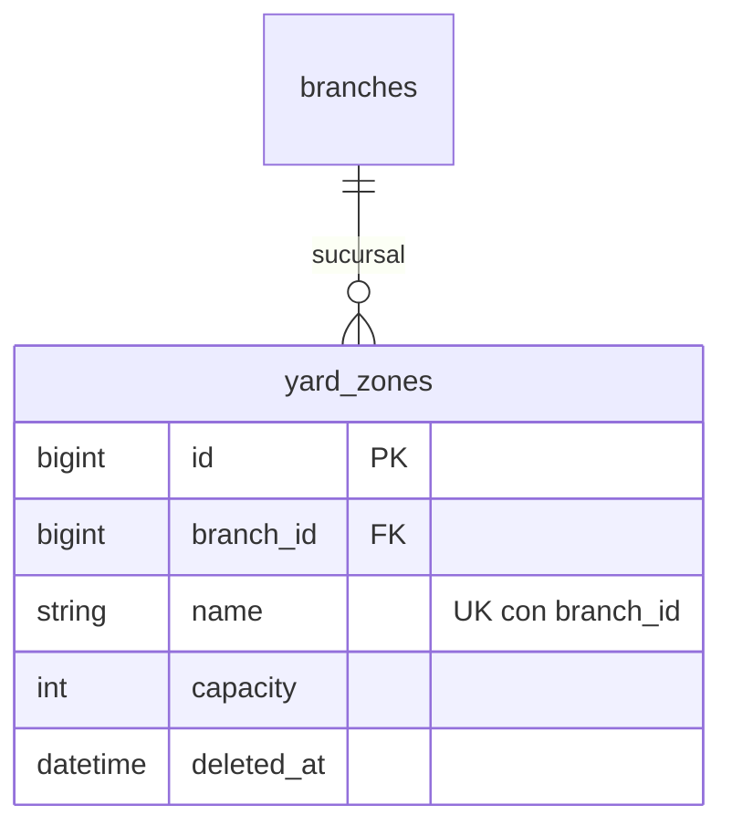

### 4.9 Certificaciones (E5)

El inspector asigna el kit a una unidad con una solicitud de retiro de SIGLA 1.0 y un kit despachado (H17). De la solicitud se guardan su id, su booking, su contenedor, su cliente y su producto; lo demás se enlaza con los catálogos. Al asignar, las secciones activas se copian como pasos de la certificación, con los dispositivos del kit que el sistema reparte en cada una, y la inspección interna y la externa suben sus fotos a esos pasos (H18). Con las dos completas se cierra a mano, y una cerrada se puede reaperturar con un motivo (H19).

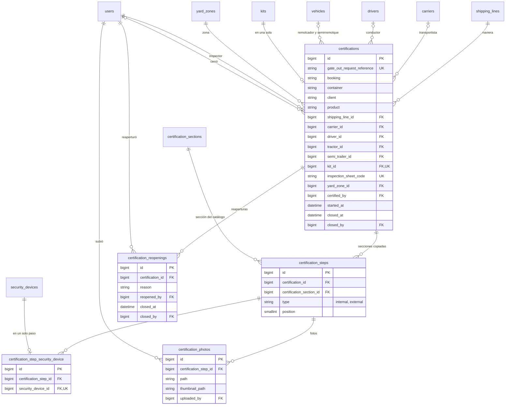

## 5. Diccionario de tablas

Notación: `UK` único · `FK` llave foránea. Todo es `NOT NULL` salvo donde dice «null».

### 5.1 `users` · `en código`

Columnas base: `id`, `name`, `email` (UK), `email_verified_at` (null), `password`, `remember_token` (null), columnas de doble factor (null), `profile_photo_path` (null), `timestamps`, `deleted_at` (null; reemplazó a `is_active` el 2026-11-03).

Documento y sucursal (T19):

| Columna | Tipo | Notas |
| --- | --- | --- |
| `identity_id` | varchar(50) FK → `identities.id` | Tipo de documento. |
| `document_number` | varchar(15) | Obligatorio. UK compuesta `(identity_id, document_number)`. |
| `branch_id` | bigint FK → `branches.id` | Obligatoria. Un usuario pertenece a **una sola** sucursal. |

Consecuencias:
- H04: el modal de crear y editar pide tipo y número de documento y sucursal.
- Se descarta `current_team_id` y la tabla puente `branches_has_users` del ER.
- H15 y H17: `identity_id` + `document_number` también sirven para reconocer al inspector que inició sesión contra `workers` (sección 7).
- Las tres columnas son obligatorias. Si al migrar ya hay usuarios, se cargan los catálogos y cada usuario queda con tipo `-` (Sin documento), su `id` como número provisional y la sede principal (`0000`), para corregirlos desde la pantalla de usuarios. El seeder crea el primer usuario con DNI `00000000`, también provisional.
- El número de documento no se muestra en la lista de usuarios y va oculto al serializar el modelo.

### 5.2 `passkeys` · `en código`

Creada por el starter kit. `id`, `user_id` (FK → `users`, borra en cascada), `name`, `credential_id` (UK), `credential` (json), `last_used_at` (null), `timestamps`.

### 5.3 `identities` · `en código`

Catálogo SUNAT 06. Seeder, sin pantalla. **Sin** `deleted_at` (excepción).

| Columna | Tipo | Notas |
| --- | --- | --- |
| `id` | varchar(50) PK | Código SUNAT; no autoincremental. |
| `description` | varchar(200) | |
| `timestamps` | | |

Doce filas: `-` Sin documento · `0` DOC.TRIB. · `1` DNI · `2` Código IICL · `4` Carnet de extranjería · `6` RUC · `7` Pasaporte · `A` Cédula Diplomática · `B` DOC.IDENT.EXTRANJERO · `C` TIN · `D` IN · `E` TAM.

Reglas: en usuarios (y luego en trabajadores) se puede elegir cualquier código. Con `-` el número sigue siendo obligatorio y único.

### 5.4 `branches` · `en código`

El seeder carga una sola si no hay ninguna: `0001` Depot Paita - Macromar (cambiado por el usuario el 2026-11-13; antes cargaba también `0000` Sede Principal). Después se gestionan en su pantalla (H27).

| Columna | Tipo | Notas |
| --- | --- | --- |
| `id` | bigint PK | |
| `company_id` | bigint FK → `companies.id` | Obligatoria. |
| `code` | varchar(20) | UK. Se asigna solo: el número más alto + 1, con 4 dígitos, contando las desactivadas. No se edita. |
| `name` | varchar(255) | |
| `phone`, `email`, `website` | varchar | null. |
| `ubigeo`, `address` | varchar | Ubigeo de 6 dígitos. |
| `timestamps`, `deleted_at` | | No se desactiva si tiene usuarios activos o si es la última activa. |

### 5.5 `companies` · `en código`

Por ahora hay **una sola empresa** (MACROMAR LOGISTICS). El seeder solo la crea si no existe; después se modifica en su pantalla (H27). Si el sistema escala a multitenancy, se pasa a varias: `branches.company_id` ya deja lista esa relación (decisión del usuario del 2026-11-04).

| Columna | Tipo | Notas |
| --- | --- | --- |
| `id` | bigint PK | |
| `ruc` | varchar(11) | UK. |
| `business_name` | varchar(255) | Razón social. Origen: `razonSocial`. |
| `trade_name` | varchar(255) | null. Nombre comercial. Origen: `nombreComercial`. |
| `address` | varchar(255) | Origen: `direccion`. |
| `ubigeo` | varchar(255) | 6 dígitos. |
| `logo_path` | varchar(255) | null. Ruta en el disco `public`. |
| `detraction_account` | varchar(255) | null. |
| `invoice_header`, `invoice_footer` | text | null. Hasta 1000 caracteres. |
| `sol_user` | varchar(255) | null. |
| `sol_pass` | text | null. **Cifrada** con `APP_KEY`. |
| `client_id` | varchar(255) | null. |
| `client_secret` | text | null. **Cifrado** con `APP_KEY`. |
| `certificate` | text | null. PEM con el certificado y su clave privada, hasta 32 KB, **cifrado** con `APP_KEY`. |
| `production` | boolean | Por defecto `false`. |
| `timestamps` | | |

Los datos de facturación solo se guardan: SIGLA no factura todavía y ningún proceso los usa (decisión del usuario del 2026-11-04). Las credenciales no van en seeders, no se devuelven al navegador ni se serializan. Si se cambia `APP_KEY`, hay que declarar la anterior en `APP_PREVIOUS_KEYS`; si se pierde, hay que volver a cargarlas.

### 5.6 `shipping_lines` · `en código`

| Columna | Tipo | Notas |
| --- | --- | --- |
| `id` | bigint PK | |
| `code` | varchar(20) | UK (criterio 2). Se guarda sin espacios a los lados y en mayúsculas. |
| `name` | varchar(100) | |
| `timestamps`, `deleted_at` | | Desactivar = `deleted_at`. |

`ShippingLineSeeder` carga las 29 navieras iniciales dadas por el usuario el 2026-11-16 (de MAEU, Maersk Line, a DOLP, Dole Ocean Cargo Express). Si un código ya existe, aunque esté desactivado, no lo toca.

### 5.7 `providers` · `en código`

Global (sin sucursal). Solo lo que pide H10; `cuenta_cte` y `detalle_servicio` del ER quedan fuera.

| Columna | Tipo | Notas |
| --- | --- | --- |
| `id` | bigint PK | |
| `identity_id` | varchar(50) FK | Tipo de documento: solo RUC (`6`) o DNI (`1`), según H10; constantes `Identity::RUC` e `Identity::DNI`. |
| `document_number` | varchar(15) | UK compuesta con `identity_id` (criterio 2). |
| `business_name` | varchar(255) | ER: `razon_social`. |
| `address`, `email` | varchar(255) (null) | Opcionales (H10, criterio 1). Vacío se guarda como null. |
| `phone` | varchar(20) (null) | Opcional (H10, criterio 1). |
| `timestamps`, `deleted_at` | | Desactivar = `deleted_at` (criterio 4). |

### 5.7b `clients` · `en código`

Clientes (H31), global (sin sucursal). Copia de `providers` con un atributo más, la condición de pago (decisión del usuario del 2026-11-17). La usa el despacho a granel por venta (H30).

| Columna | Tipo | Notas |
| --- | --- | --- |
| `id` | bigint PK | |
| `identity_id` | varchar(50) FK | Tipo de documento: solo RUC (`6`) o DNI (`1`), como en `providers`. |
| `document_number` | varchar(15) | UK compuesta con `identity_id` (criterio 3), aunque el cliente esté desactivado. |
| `business_name` | varchar(255) | Con DNI, los nombres y apellidos. |
| `address`, `email` | varchar(255) (null) | Opcionales (criterio 1). Vacío se guarda como null. |
| `phone` | varchar(20) (null) | Opcional (criterio 1). |
| `payment_condition` | varchar(20) | Enum `PaymentCondition`: `cash` (Contado) o `credit` (Crédito). Por defecto `cash` (criterio 2). |
| `credit_days` | smallint unsigned (null) | Días de crédito, de 1 a 365. Obligatorio con `credit`; null con `cash` (criterio 2). |
| `timestamps`, `deleted_at` | | Desactivar = `deleted_at` (criterio 5). |

### 5.8 `security_device_types` · `en código`

| Columna | Tipo | Notas |
| --- | --- | --- |
| `id` | bigint PK | |
| `name` | varchar(100) | UK (criterio 2). Se guarda sin espacios a los lados. |
| `kind` | varchar(20) | Enum de PHP `SecurityDeviceKind`, lista fija: `seal` (sello), `container_seal` (precinto), `tape` (cinta), `other` (otro). ER: `type`. No se edita después de crear. |
| `splits_internal_external` | boolean | Por defecto `false`. Si está marcado, en el tipo de kit su cantidad se reparte entre la asignación interna y la externa (casilla en crear y editar; corrección del 2026-11-16, T55). Se puede cambiar al editar: los tipos de kit ya guardados conservan sus cantidades hasta que se editen. |
| `timestamps`, `deleted_at` | | Desactivar = `deleted_at` (criterio 4). Los tipos no se eliminan (criterio 5). |

`SecurityDeviceTypeSeeder` carga los 8 tipos iniciales de los diseños de H12 y H13, pedidos por el usuario el 2026-11-12: cinta de inspección, puerta empty y puerta full (`tape`); sello botella, cable y plástico (`seal`); precinto de naviera (`container_seal`) y formato de inspección (`other`). Solo la cinta de inspección se reparte entre interna y externa. Si un tipo ya existe, aunque esté desactivado, no lo toca. (Corregido el 2026-11-16, T55: la cinta interna y la externa eran un solo tipo, la cinta de inspección. El seeder no borra ni renombra las dos de una base ya cargada.)

### 5.9 `security_device_announcements` · `en código`

El origen de un lote: de quién viene y cómo se arman sus series. Se crea uno por lote, en el mismo guardado; bodega no lo gestiona aparte (P2, cerrada el 2026-11-10).

| Columna | Tipo | Notas |
| --- | --- | --- |
| `id` | bigint PK | |
| `shipping_line_id` | bigint FK | Naviera activa al ingresar el lote (H07, criterio 1). |
| `provider_id` | bigint FK | Proveedor activo. Vive solo aquí: el lote no lo repite. |
| `security_device_type_id` | bigint FK | Tipo activo (H07, criterio 2). |
| `series_prefix` | varchar(20) | Prefijo de la serie en columna propia, por ejemplo `GSW`. Letras y números, en mayúsculas. |
| `min_digits` | tinyint sin signo | Mínimo de dígitos del correlativo, de 1 a 15. |
| `series_start`, `series_end` | bigint sin signo | Correlativos como números (el ER los tenía como texto), hasta 15 dígitos. `series_start` ≤ `series_end`. |
| `series_suffix` | varchar(10) (null) | Final de serie, opcional: solo letras, en mayúsculas (pedido por el usuario el 2026-11-10). |
| `timestamps` | | |

La serie de cada dispositivo es `series_prefix` + el correlativo con ceros a la izquierda hasta `min_digits` + `series_suffix`, sin separador; un correlativo más largo queda completo (H07, criterio 5). Ejemplo: `GWF` + `100` con 5 dígitos + `A` = `GWF00100A`. La fórmula está en `SecurityDeviceAnnouncement::serialNumber()`.

### 5.10 `security_device_lots` · `en código`

| Columna | Tipo | Notas |
| --- | --- | --- |
| `id` | bigint PK | |
| `security_device_announcement_id` | bigint FK | UK: un anuncio, un lote. |
| `quantity` | smallint sin signo | Dispositivos del lote, de 1 a 10 000 (H07, criterio 10). ER: `qty`. |
| `received_at` | date | Fecha de recepción. ER: `date_reception`. |
| `dispatch_number` | varchar(50) | Número de guía. ER: `despatch_number`. |
| `notes` | text (null) | Observaciones, opcionales. ER: `observations`. |
| `created_by` | bigint FK → `users` | Quién ingresó el lote; cuándo es `created_at` (H07, criterio 9). |
| `timestamps` | | |

### 5.11 `security_devices` · `en código`

| Columna | Tipo | Notas |
| --- | --- | --- |
| `id` | bigint PK | |
| `security_device_lot_id` | bigint FK | Lote del que vino. |
| `serial_number` | varchar(50) | UK: cada dispositivo es único. ER: `serie_number`. |
| `status` | varchar(20) | Índice. Enum de PHP `SecurityDeviceStatus`: `inactive` (Inactivo, el inicial, hasta que se registra la aprobación de la naviera; H29, 2026-11-16), `available` (Disponible), `in_kit` (En un kit), `used` (Usado), `damaged` (Dañado) y `dispatched` (Despachado, al salir en un despacho a granel, H30). Confirmados el 2026-11-09 (T27). |
| `security_device_lot_approval_id` | bigint FK (null) | Aprobación que lo pasó a Disponible (H29). Null mientras siga Inactivo. Quién y cuándo se leen de la aprobación. |
| `timestamps` | | |

El lote, su anuncio y sus dispositivos se guardan en una sola transacción: si una serie ya existe, no se guarda nada (H07, criterios 6 y 7). Se descartó `location` del ER. La migración de H29 pasó a `inactive` los dispositivos que estaban `available`, porque ninguno tenía la aprobación registrada.

### 5.11b `security_device_lot_approvals` · `en código`

Bitácora de aprobaciones de la naviera por tramos de un lote (H29). Un registro por cada aprobación. Se escribe junto con el cambio de estado de sus dispositivos, en una transacción. No se edita ni se borra: una aprobación no se deshace.

| Columna | Tipo | Notas |
| --- | --- | --- |
| `id` | bigint PK | |
| `security_device_lot_id` | bigint FK | Lote del tramo. |
| `correlative_start`, `correlative_end` | bigint sin signo | Tramo pedido, dentro del rango del lote, con el inicial no mayor que el final. Las series se arman con el anuncio del lote. |
| `approved_count` | smallint sin signo | Cuántos dispositivos Inactivos del tramo pasaron a Disponible. Los ya aprobados no se cuentan. Siempre mayor que 0: si no hay nada que aprobar, no se guarda el registro. |
| `approved_by` | bigint FK → `users` | Quién registró la aprobación; cuándo es `created_at`. |
| `timestamps` | | |

### 5.12 `certification_sections` · `planeada (T35/H11)`

Secciones del contenedor que se inspeccionan. ER: `certification_criteria_items`.

| Columna | Tipo | Notas |
| --- | --- | --- |
| `id` | bigint PK | |
| `name` | varchar(100) | UK, aunque la sección esté desactivada (H11, criterio 2). |
| `type` | varchar(20) | Enum de PHP `CertificationSectionType`: `internal` (Interna) o `external` (Externa). Las puertas no son un tipo (P1). |
| `sort_order` | smallint sin signo (null) | Índice. Posición entre las activas, desde 1: es el orden de los pasos de la certificación, uno solo para internas y externas. Una nueva o reactivada va al final; al desactivarla queda en null y las demás se corren. |
| `timestamps`, `deleted_at` | | Desactivar = `deleted_at`. |

### 5.12b `certification_section_security_device_type` · `planeada (T38/H12)`

Lo que el inspector coloca en cada sección: cuántos dispositivos de cada tipo (H12). Tabla puente pura, sin marcas de tiempo. Se escribe junto con `certification_sections`, en una transacción, al crear o editar la sección.

| Columna | Tipo | Notas |
| --- | --- | --- |
| `certification_section_id` | bigint FK | PK compuesta con `security_device_type_id`: un tipo de dispositivo va una sola vez en una sección (criterio 6). Llaves con nombre corto, porque el automático pasa los 64 caracteres de MariaDB. |
| `security_device_type_id` | bigint FK | Tipo de dispositivo (`security_device_types`). Solo se eligen los activos, pero se conserva uno desactivado que la sección ya llevaba (decisión del usuario del 2026-11-12). |
| `quantity` | smallint sin signo | Entero de 1 a 999 (criterio 5). |

Una sección sin filas aquí solo pide fotos («Solo foto», criterio 4). Cambiar lo que lleva no toca las certificaciones cerradas (criterio 9): H17 guardará en cada certificación lo que pidió cada sección.

### 5.13 `carriers` · `en código`

Transportistas (empresas). Global, sin sucursal. Independiente de conductores y vehículos (decisión confirmada por el usuario el 2026-11-11).

| Columna | Tipo | Notas |
| --- | --- | --- |
| `id` | bigint PK | |
| `identity_id` | varchar(50) FK | Siempre RUC (`6`, `Identity::RUC`); el usuario no lo elige. Se deja la columna para seguir el patrón de `providers`. |
| `document_number` | varchar(15) | RUC de 11 dígitos. UK compuesta con `identity_id`, aunque esté desactivado (H21, criterio 2). |
| `business_name` | varchar(255) | Razón social. |
| `address`, `email` | varchar(255) (null) | Opcionales (H21, criterio 1). Vacío se guarda como null. |
| `phone` | varchar(20) (null) | Opcional (H21, criterio 1). |
| `timestamps`, `deleted_at` | | Desactivar = `deleted_at` (H21, criterio 5). |

### 5.14 `drivers` · `en código`

Conductores. Global, sin sucursal. Se registran una sola vez y se enlazan con sus transportistas en `carrier_driver` (T45). Su `deleted_at` queda sin uso en pantalla: se desactivan por transportista. El DNI y el brevete son datos personales: hasta H24 los ve cualquier usuario con sesión, y nunca van en URLs ni en logs (la búsqueda de su tabla no viaja en la URL).

| Columna | Tipo | Notas |
| --- | --- | --- |
| `id` | bigint PK | |
| `identity_id` | varchar(50) FK | Siempre DNI (`1`, `Identity::DNI`); el usuario no lo elige. |
| `document_number` | varchar(15) | DNI de 8 dígitos. UK compuesta con `identity_id`, aunque esté desactivado (H22, criterio 2). |
| `full_name` | varchar(255) | Índice. Nombres y apellidos en un solo campo, como los entrega la API de SIGLA 1.0 (decisión del usuario del 2026-11-11). |
| `license` | varchar(15) | UK, aunque esté desactivado. Brevete obligatorio, texto libre en mayúsculas y sin espacios, para servir también a extranjeros (aprobado el 2026-11-11). |
| `timestamps`, `deleted_at` | | Desactivar = `deleted_at` (H22, criterio 5). |

### 5.14b `carrier_driver` · `planeada (T45/H22)`

Los conductores de cada transportista (corrección de H22 del 2026-11-11, pensando en la extranet). Un conductor puede estar en varios transportistas.

| Columna | Tipo | Notas |
| --- | --- | --- |
| `id` | bigint PK | Lleva `id` propio para desactivar y reactivar el enlace. |
| `carrier_id` | bigint FK | Transportista. UK compuesta con `driver_id`. |
| `driver_id` | bigint FK | Conductor. |
| `timestamps`, `deleted_at` | | Desactivar el conductor **en ese transportista** = `deleted_at` del enlace. No toca a los demás transportistas. Agregar de nuevo un enlace desactivado lo reactiva. |

### 5.15 `vehicle_bodies` · `en código`

Carrocerías, como REMOLCADOR o PLATAFORMA. Una sola lista para remolcadores y semirremolques, como en SIGLA 1.0, pero gestionable desde su pantalla (decisión del usuario del 2026-11-11). El Service `VehicleRegistry` registra una nueva si llega de SIGLA 1.0 y no existe. `VehicleBodySeeder` carga las 9 iniciales que dio el usuario el 2026-11-11 (remolcador 4x2, 6x2 y 6x4, plataforma, plataforma abierta, containera, portacontenedor extensible, cisterna y chasis gooseneck).

| Columna | Tipo | Notas |
| --- | --- | --- |
| `id` | bigint PK | |
| `name` | varchar(100) | UK, aunque esté desactivada. Se guarda en mayúsculas y con espacios simples, como lo manda SIGLA 1.0. |
| `timestamps`, `deleted_at` | | Desactivar = `deleted_at`. Una desactivada no se elige en vehículos nuevos, pero los vehículos que la tienen la conservan. |

### 5.16 `vehicles` · `en código`

Remolcadores y semirremolques. No se ligan a ningún transportista.

| Columna | Tipo | Notas |
| --- | --- | --- |
| `id` | bigint PK | |
| `plate` | varchar(10) | UK, aunque esté desactivado. En mayúsculas, solo letras y números, como `ABC123`, igual que SIGLA 1.0 (decisión del usuario del 2026-11-11). |
| `brand` | varchar(100) | Marca. |
| `kind` | varchar(20) | Índice. Enum de PHP `VehicleKind`: `tractor` (Remolcador) o `semi_trailer` (Semirremolque), como el glosario. Desde SIGLA 1.0 sale de dónde viene la placa: `placa_tracto` o `placa_carreta`. |
| `vehicle_body_id` | bigint FK | Carrocería (`vehicle_bodies`). |
| `category` | varchar(10) | Índice. Enum de PHP `VehicleCategory`: la lista fija de SIGLA 1.0, `N1`, `N2`, `N3`, `O1`, `O2`, `O3`, `O4` y `other` (OTRO). N3 por defecto. Un texto fuera de la lista que llegue de SIGLA 1.0 se guarda como `other`. |
| `color` | varchar(30) (null) | Opcional, texto libre en mayúsculas; vacío se guarda como null. Desde SIGLA 1.0 sale de `color_tracto` o `color_carreta` (agregado a pedido del usuario el 2026-11-11). |
| `timestamps`, `deleted_at` | | Desactivar = `deleted_at`. |

Sin `needs_review`: el vehículo que llega de SIGLA 1.0 se registra directo en el catálogo con `VehicleRegistry` (decisión del usuario del 2026-11-11).

### 5.17 `container_types` · `planeada (T39/H13)`

Tipos de contenedor. Sin pantalla: `ContainerTypeSeeder` carga los 15 que dio el usuario el 2026-11-12 (estándar, high cube, hardtop, open top, reefer, flat rack y plataforma) y no toca los que ya existen. En pantalla se muestran como «código · descripción», por ejemplo «40RF · 40'-RFHC Reefer High Cube».

| Columna | Tipo | Notas |
| --- | --- | --- |
| `id` | bigint PK | |
| `code` | varchar(6) | UK. Código interno, como `40RF`. |
| `iso_code` | varchar(4) | UK. Código ISO 6346, como `45R1`. |
| `description` | varchar(100) | Como `40'-RFHC Reefer High Cube`. |
| `is_reefer` | boolean | Falso por defecto. |
| `length`, `width`, `height` | decimal(8,2) | Medidas en metros. |
| `timestamps`, `deleted_at` | | Desactivar = `deleted_at`. Un tipo de kit conserva su tipo de contenedor aunque se desactive. |

### 5.18 `kit_types` · `planeada (T39/H13)`

Tipos de kit (H13). Se gestionan en Bodega → Tipos de kit.

| Columna | Tipo | Notas |
| --- | --- | --- |
| `id` | bigint PK | |
| `name` | varchar(100) | UK, aunque esté desactivado (criterio 4). Se guarda como se escribe, sin espacios a los lados. |
| `container_type_id` | bigint FK | Tipo de contenedor (`container_types`). Solo se eligen los activos. |
| `timestamps`, `deleted_at` | | Desactivar = `deleted_at` (criterio 6). Uno desactivado no aparece al crear kits (H14). |

### 5.19 `kit_type_security_device_type` · `planeada (T39/H13)`

Lo que lleva cada tipo de kit: cuántos dispositivos de cada tipo (criterio 7). Tabla puente pura, sin marcas de tiempo. Se escribe junto con `kit_types`, en una transacción.

| Columna | Tipo | Notas |
| --- | --- | --- |
| `kit_type_id` | bigint FK | PK compuesta con `security_device_type_id`: un tipo de dispositivo no se repite en un tipo de kit (criterio 3). |
| `security_device_type_id` | bigint FK | Tipo de dispositivo (`security_device_types`). Solo se eligen los activos, pero se conserva uno desactivado que el tipo de kit ya llevaba. |
| `quantity` | smallint sin signo | Entero de 1 a 999. Cada tipo de kit lleva al menos un tipo de dispositivo. En un tipo de dispositivo que se reparte, es la suma de la interna y la externa. |
| `internal_quantity` | smallint sin signo (null) | Cuántas van a la asignación interna. Solo en un tipo de dispositivo con `splits_internal_external`; si no, null (corrección del 2026-11-16, T55). |
| `external_quantity` | smallint sin signo (null) | Cuántas van a la asignación externa. Igual que la interna: enteros desde 0 que suman al menos 1. |

Editar un tipo de kit no cambia los kits ya armados (criterio 5): cada kit guarda su copia en `kit_security_device_type` (H14).

### 5.19b `kits` · `en código`

Kits que arma bodega (H14). Se crean en Bodega → Kits → Nuevo.

| Columna | Tipo | Notas |
| --- | --- | --- |
| `id` | bigint PK | |
| `pouch_code` | varchar(50) | UK. Código de barras de la funda, escaneado o escrito; se guarda en mayúsculas y sin espacios a los lados. En el ER era `series_code`: se renombra por el glosario (funda = `pouch`). |
| `kit_type_id` | bigint FK | Tipo de kit (`kit_types`). Solo se eligen los activos; no cambia después de crear el kit. |
| `shipping_line_id` | bigint FK | Naviera (`shipping_lines`). Solo se eligen las activas. El kit solo acepta dispositivos de lotes de esta naviera (criterio 13). |
| `status` | varchar(20) | Índice. Enum de PHP `KitStatus`: `building` (Armando, el inicial y mientras falten dispositivos), `built` (Armado, completo), `dispatched` (Despachado, H15) y `used` (Usado, H17). Pasa solo entre Armando y Armado al agregar o quitar (criterio 14). |
| `created_by` | bigint FK | Usuario que creó el kit (`users`). Con `created_at`, cumple el criterio 11. |
| `timestamps` | | La semana del kit no es columna: es la semana ISO de `created_at` en hora de Lima (2026-W47). |

Sin zona de patio: la elige el inspector al iniciar la certificación (H17).

### 5.19c `kit_security_device_type` · `en código`

Copia de lo que lleva el tipo de kit al crear el kit, con las mismas columnas que `kit_type_security_device_type`: `kit_id` y `security_device_type_id` (PK compuesta), `quantity`, `internal_quantity` y `external_quantity`. Tabla puente pura, sin marcas de tiempo. Se escribe junto con `kits`, en una transacción.

### 5.19d `kit_security_device` · `en código`

Dispositivos de cada kit.

| Columna | Tipo | Notas |
| --- | --- | --- |
| `id` | bigint PK | Da el orden en que se agregaron. |
| `kit_id` | bigint FK | Kit (`kits`). |
| `security_device_id` | bigint FK | UK: un dispositivo solo está en un kit (criterio 6). Al agregarlo pasa a `in_kit`; al quitarlo se borra la fila y vuelve a `available` (criterio 9). |
| `assignment` | varchar(10) (null) | Enum de PHP `KitAssignment`: `external` o `internal`, solo en un tipo de dispositivo que se reparte (cinta de inspección); si no, null. Lo elige el campo donde se escanea (cambio del usuario del 2026-11-16). |
| `timestamps` | | |

### 5.19e `kit_dispatches` · `planeada (T50/H15)`

Despachos de kits (H15). Se ven en Bodega → Despachos y se crean en el modal «Despacho masivo de kits». En el ER era `kits_dispatches`.

| Columna | Tipo | Notas |
| --- | --- | --- |
| `id` | bigint PK | Da el número que se muestra: «D-» y el id con seis dígitos (D-000013). No hay columna de número. |
| `receiver_id` | bigint FK → `workers.id` | Trabajador que recibe (criterio 1). Solo se eligen activos; uno desactivado después se conserva. |
| `created_by` | bigint FK → `users.id` | Usuario que despacha, que es quien entrega (criterios 1 y 7). Se descarta `assigned_by` del ER. |
| `timestamps` | | `created_at` es el momento del despacho (criterio 7). Índice, para filtrar por semana. La semana no es columna: es la semana ISO de `created_at` en hora de Lima. |

### 5.19f `kit_dispatch_items` · `planeada (T50/H15)`

Kits de cada despacho. En el ER era `kit_dispatches_assigned_units`.

| Columna | Tipo | Notas |
| --- | --- | --- |
| `id` | bigint PK | |
| `kit_dispatch_id` | bigint FK → `kit_dispatches.id` | |
| `kit_id` | bigint FK → `kits.id` | UK: cada kit queda en un solo despacho (criterio 5). |
| `timestamps` | | |

Se escribe junto con `kit_dispatches` y el cambio de los kits a `dispatched`, en una transacción que vuelve a bloquear y revisar cada kit.

### 5.19g `bulk_dispatches` · `en código`

Despachos a granel (H30): dispositivos sueltos, sin kit. Tienen su propia lista en Bodega → Despachos → «A granel», separada de `kit_dispatches`, y se crean en el modal «Despacho a granel». En el ER era `device_dispatches`.

| Columna | Tipo | Notas |
| --- | --- | --- |
| `id` | bigint PK | Da el número que se muestra: «DG-» y el id con seis dígitos (DG-000004). No hay columna de número. |
| `receiver_id` | bigint FK → `workers.id` | Trabajador que recibe (criterio 2). Solo se eligen activos. |
| `created_by` | bigint FK → `users.id` | Usuario que despacha, que es quien entrega (criterio 2). |
| `reason` | varchar(20) | Motivo de salida. Enum de PHP `BulkDispatchReason`: `sale` (Venta) u `operation` (Operación) (criterio 3). |
| `client_id` | bigint FK → `clients.id` (null) | Solo con `sale`: el cliente, activo al despachar. |
| `kit_id` | bigint FK → `kits.id` (null) | Solo con `operation`: el kit despachado al que van los dispositivos. Hoy solo kits `dispatched`; con H17, los de una certificación abierta. |
| `yard_zone_id` | bigint FK → `yard_zones.id` | Patio de destino: una zona activa de la sede del usuario (criterio 4). |
| `notes` | varchar(500) (null) | Observación (criterio 5). Vacía se guarda como null. |
| `timestamps` | | `created_at` es el momento del despacho. La semana es la semana ISO de `created_at` en hora de Lima. |

### 5.19h `bulk_dispatch_items` · `en código`

Dispositivos de cada despacho a granel. En el ER era `device_dispatches_units`.

| Columna | Tipo | Notas |
| --- | --- | --- |
| `id` | bigint PK | |
| `bulk_dispatch_id` | bigint FK → `bulk_dispatches.id` | |
| `security_device_id` | bigint FK → `security_devices.id` | UK: cada dispositivo queda en un solo despacho a granel (criterio 10). |
| `timestamps` | | |

Se escribe junto con `bulk_dispatches` y el cambio de los dispositivos a `dispatched`, en una transacción que vuelve a bloquear y revisar cada dispositivo (todo o nada).

### 5.20 `workers` · `en código`

Trabajadores (H25). Global (sin sucursal). Se gestionan en Maestros → Trabajadores.

| Columna | Tipo | Notas |
| --- | --- | --- |
| `id` | bigint PK | |
| `identity_id` | varchar(50) FK | Tipo de documento: cualquiera del catálogo `identities`, como en usuarios. |
| `document_number` | varchar(15) | UK compuesta con `identity_id`, aunque el trabajador esté desactivado (criterio 2). Con DNI, 8 dígitos. |
| `full_name` | varchar(255) | Nombres y apellidos en un solo campo, como en `drivers`. Con DNI se completa desde RENIEC al crear. |
| `position` | varchar(100) (null) | Cargo, opcional y en texto libre (pedido del usuario del 2026-11-13). Vacío se guarda como null. |
| `is_own` | boolean | `true` si es propio (criterio 1). |
| `provider_id` | bigint FK (null) | Proveedor (`providers`). Null si `is_own`. Se elige con un selector que busca en el servidor (solo activos), o se crea ahí mismo con «Agregar»; se conserva uno desactivado que el trabajador ya tenía. |
| `timestamps`, `deleted_at` | | Desactivar = `deleted_at` (criterio 4). Uno desactivado no aparece al despachar kits (H15). |

Sin llave hacia `users` (criterio 6). Desde el 2026-11-17 (H15) ya no se compara su documento con el del usuario: el trabajador que recibe un despacho no limita qué kits usa el inspector.

### 5.21 `yard_zones` · `planeada (T44/H26)`

Zonas de patio (H26). Se gestionan en Maestros → Zonas de patio. El seeder carga una sola si no hay ninguna: «Zona certificación», con capacidad 50, en la sucursal `0001` (pedido del usuario del 2026-11-13).

| Columna | Tipo | Notas |
| --- | --- | --- |
| `id` | bigint PK | |
| `branch_id` | bigint FK → `branches.id` | Obligatoria. Al crear y editar solo se ofrecen sucursales activas; se conserva una desactivada que la zona ya tenía. |
| `name` | varchar(100) | UK compuesta con `branch_id`, aunque la zona esté desactivada (criterio 2). El mismo nombre puede repetirse en otra sucursal. |
| `capacity` | int unsigned | Obligatoria, entero mayor que 0, en contenedores. Solo informativa (criterio 6). |
| `timestamps`, `deleted_at` | | Desactivar = `deleted_at` (criterio 4). Una desactivada no aparece al iniciar una certificación, pero la conservan las ya hechas. |

### 5.22 `certifications` · `en código`

Certificaciones de contenedores (H17). Se crean en la Asignación, desde Inspección → Certificaciones. En el ER era `security_certifications`. Por decisión del usuario del 2026-11-17, de la solicitud de retiro se guardan su id, su booking y su contenedor, para volver a consultarla en SIGLA 1.0; desde el 2026-11-20 (T58) también su cliente y su producto, para que el detalle y el PDF no dependan de la API. El DNI y el brevete nunca se copian: están en `drivers`.

| Columna | Tipo | Notas |
| --- | --- | --- |
| `id` | bigint PK | |
| `gate_out_request_reference` | varchar(50) | UK: el id de la solicitud de SIGLA 1.0 (`id_solicitud`). Una solicitud tiene una sola certificación (criterio 6). |
| `booking` | varchar(50) | El booking de la solicitud, para volver a consultarla. |
| `container` | varchar(50) | El contenedor completo (ABCU1234567). En pantalla se escribe en dos partes, pero se guarda y se consulta junto. |
| `client` | varchar(255) (null) | El cliente (operador) de la solicitud, como lo manda SIGLA 1.0 (T58). |
| `product` | varchar(255) (null) | El producto de la solicitud, como lo manda SIGLA 1.0 (T58). |
| `shipping_line_id` | bigint FK → `shipping_lines.id` | La naviera de la solicitud, buscada por nombre sin distinguir mayúsculas. Si estaba desactivada, se reactiva; si no existe, se crea con un código de 4 caracteres tomado del nombre (SEAT) y un número si se repite (MAER1). |
| `carrier_id` | bigint FK → `carriers.id` (null) | Buscado por RUC o creado (criterio 3). Null si SIGLA 1.0 no manda el RUC o la razón social. |
| `driver_id` | bigint FK → `drivers.id` (null) | Buscado por DNI o creado, y enlazado con el transportista en `carrier_driver` (criterio 3). Null si SIGLA 1.0 no manda el DNI, el nombre o el brevete. |
| `tractor_id` | bigint FK → `vehicles.id` (null) | Remolcador, buscado por placa o creado con `VehicleRegistry`. Null si falta la placa, la marca o la carrocería. |
| `semi_trailer_id` | bigint FK → `vehicles.id` (null) | Semirremolque, igual que el remolcador. |
| `kit_id` | bigint FK → `kits.id` | UK: un kit va en una sola certificación (criterio 8). Debe estar `dispatched` y ser de la misma naviera de la solicitud. Al iniciar, el kit sigue `dispatched`. |
| `inspection_sheet_code` | varchar(50) (null) | Código de barras del formato de inspección, opcional. UK: no se repite en otra certificación. |
| `yard_zone_id` | bigint FK → `yard_zones.id` | Zona activa de la sede del usuario (criterio 13). |
| `certified_by` | bigint FK → `users.id` | El inspector que la inició (criterio 9). |
| `started_at` | datetime | Fecha y hora de inicio (criterio 9). |
| `closed_at` | datetime (null) | Fecha y hora del último cierre (H19, criterio 4). Null mientras está abierta o reaperturada. |
| `closed_by` | bigint FK → `users.id` (null) | Quién la cerró la última vez. Null igual que `closed_at`. |
| `timestamps` | | |

No guarda un `status`: el estado se calcula (enum de PHP `CertificationStatus`, H19 y H20). `closed` (Cerrada) si tiene `closed_at`; `reopened` (Reaperturada) si no lo tiene y tiene reaperturas; `ready_to_close` (Lista para cerrar) si cada paso tiene al menos una foto; si no, `in_progress` (A medias). Al cerrarla, el kit y sus dispositivos pasan a `used` en la misma transacción. Al asignarla, se escribe junto con la naviera, el transportista, el conductor, su enlace, los vehículos que falten y sus pasos, en una transacción que vuelve a bloquear y revisar el kit (todo o nada, criterio 4). El kit se asigna solo si tiene exactamente lo que piden las secciones activas (criterio 16).

### 5.22b `certification_reopenings` · `en código`

Las reaperturas de una certificación cerrada (H19, criterio 7). Cada una guarda su motivo, quién la reaperturó y cuándo, y también el cierre que deshizo, para que no se pierda ningún cierre. Al reaperturar, el kit y sus dispositivos siguen en `used`.

| Columna | Tipo | Notas |
| --- | --- | --- |
| `id` | bigint PK | |
| `certification_id` | bigint FK → `certifications.id` | Índice con `created_at`. |
| `reason` | varchar(500) | El motivo, obligatorio. |
| `reopened_by` | bigint FK → `users.id` | Quién la reaperturó. |
| `closed_at` | datetime | Cuándo se había cerrado. |
| `closed_by` | bigint FK → `users.id` | Quién la había cerrado. |
| `timestamps` | | `created_at` es la fecha y hora de la reapertura. |

### 5.23 `certification_steps` · `en código`

Las secciones activas del catálogo (`certification_sections`), copiadas en la certificación al asignar el kit (H18). La copia guarda el tipo y la posición que la sección tenía, para que un cambio posterior del catálogo no cambie la certificación. El tipo dice a qué inspección pertenece el paso: la interna o la externa.

| Columna | Tipo | Notas |
| --- | --- | --- |
| `id` | bigint PK | |
| `certification_id` | bigint FK → `certifications.id` | |
| `certification_section_id` | bigint FK → `certification_sections.id` | UK junto con `certification_id`: una sección va una sola vez en cada certificación. |
| `type` | varchar(20) | Enum de PHP `CertificationSectionType`: `internal` o `external`, copiado de la sección. Índice con `certification_id` y `position`. |
| `position` | smallint | Orden del paso, el de la sección en el catálogo al asignar. |
| `timestamps` | | |

### 5.24 `certification_step_security_device` · `en código`

Los dispositivos del kit que el sistema coloca en cada paso, según lo que pide la sección (H12). Una cinta que se reparte va a los pasos de su lado: las internas a las secciones internas y las externas a las externas (T55).

| Columna | Tipo | Notas |
| --- | --- | --- |
| `id` | bigint PK | |
| `certification_step_id` | bigint FK → `certification_steps.id` | |
| `security_device_id` | bigint FK → `security_devices.id` | UK: un dispositivo va en un solo paso. |
| `timestamps` | | |

### 5.25 `certification_photos` · `en código`

Las fotos de cada paso (H18), de 1 a n, sin máximo. Se toman con la cámara del teléfono y se comprimen en el navegador (unos 1920 px y 700 KB, con la marca de agua de fecha, hora y contenedor), que también arma la miniatura de 320 px. Los dos archivos van en el disco privado (`storage/app/private/certifications/{id}`) y solo se sirven con sesión. El inspector, el inicio y el fin de cada inspección salen de sus fotos.

| Columna | Tipo | Notas |
| --- | --- | --- |
| `id` | bigint PK | |
| `certification_step_id` | bigint FK → `certification_steps.id` | Índice con `created_at`. |
| `path` | varchar(255) | Ruta de la foto en el disco privado. |
| `thumbnail_path` | varchar(255) | Ruta de la miniatura, en la subcarpeta `thumbnails`. |
| `uploaded_by` | bigint FK → `users.id` | Quién la subió. Al reemplazarla, quien la reemplazó. |
| `timestamps` | | `created_at` es la fecha y hora de la subida; al reemplazar la foto, toma la del reemplazo. |

## 6. Cambios del ER original que ya aplican

- `int` → `bigint`; casi todo nulo → `NOT NULL`.
- Tablas descartadas: `branches_has_users`.
- Columnas descartadas: `users.current_team_id`, `branches.dt_code`, `providers.branch_id`, `providers.cuenta_cte`, `providers.detalle_servicio`, `shipping_lines.created_by` (decisión del usuario del 2026-11-04).
- Nuevas: `users.identity_id/document_number/branch_id`, tabla `identities`.
- De la empresa, los datos de facturación electrónica entran vacíos con H27, y las credenciales se cargan desde la pantalla: nunca en texto plano ni en seeders.
- Renombres: `razon_social` → `business_name`, `type` → `kind` en tipos de dispositivo.

## 7. Decisiones guardadas para sprints siguientes

No se migran ahora. Cada fila se amplía (diagrama y diccionario) cuando su historia entra a un sprint. Los nombres son los decididos; los marcados «propuesta» no están confirmados.

| Tabla (nombre en el ER) | Historia | Decisiones |
| --- | --- | --- |
| `certification_photos` (`external_/internal_certification_photos`) | H18 | `por decidir` (E5 en revisión). Propuesta: una sola tabla. |
| `affectations`, `containers` | — | `futura`. `containers` trae ids sueltos sin tabla (`reefer_technolgy_id`, `reefer_machine_id`, `warehouse_id`, `own_line_id`). |

Tablas de roles y permisos: se definen al aprobar H24.

## 8. Pendientes por decidir

| # | Tema | Detalle |
| --- | --- | --- |
| P1 | «Puertas» | Cerrada el 2026-11-12: las puertas son una sección externa más, con sus cintas y precintos (H12). |
| P3 | Fotos | Cerrada el 2026-11-20 en H18: una tabla, `certification_photos`, con la foto y su miniatura en la misma fila. |
| P4 | Certificación | Cerrada el 2026-11-20 en H19: el estado se calcula, sin columna `status`, y el cierre va en `closed_at` y `closed_by`. Desde H17, remolcador y semirremolque son opcionales: se enlazan solo si SIGLA 1.0 manda sus datos. `source` (`api`/`web`) y la reinspección se agregan con sus historias. |
| P6 | Llave de `identities` | Se construyó en T19 con `id` varchar(50) y el código SUNAT. Alternativa: `id` numérico y `code` aparte; cambiarlo después requiere una migración. |