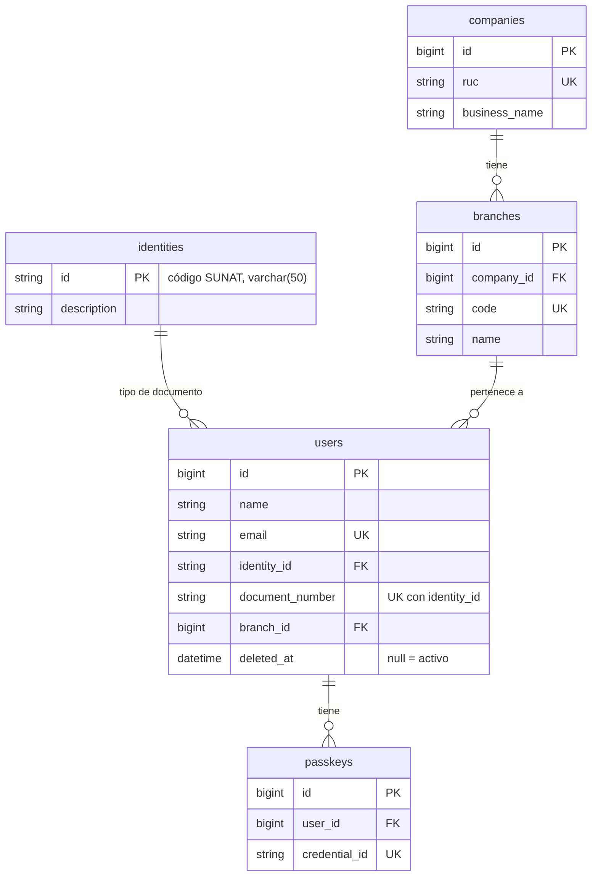
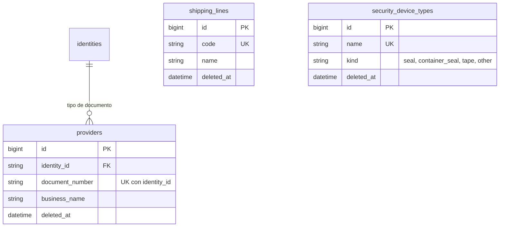
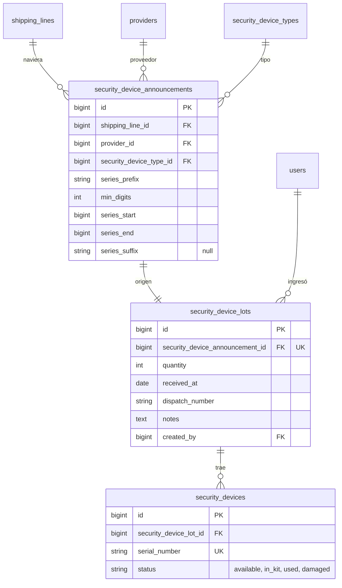
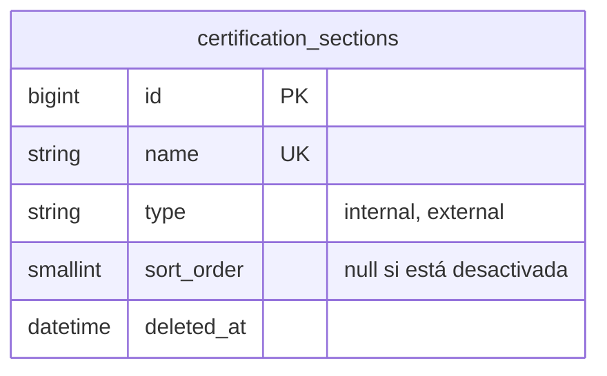
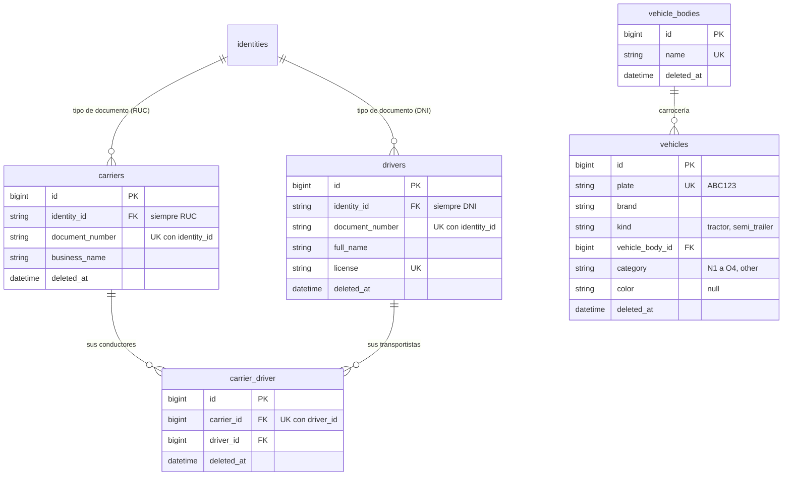

# Modelo de datos · SIGLA 2.0 (TOS)

Este documento es la **fuente de verdad del modelo de datos**. Crece con el producto: solo tiene diagrama y diccionario de las tablas que existen o que entran en el sprint en curso. Lo que viene después queda como decisiones guardadas (sección 7), sin diagrama, y se promueve al diccionario cuando su historia entra a un sprint.

**Alcance actual:** Sprint 1 (2026-11-02 a 2026-11-06) y Sprint 2 (H10, H07, H11, H21, H22, H23) · **Última revisión:** 2026-11-11 · **Estado:** aprobado por el usuario el 2026-11-04.

Base de partida: el ER del usuario (`SIGLA2.0.mwb`, 29 tablas), las migraciones del repo y el cuestionario de la tarea T18. Si el ER y este documento difieren, manda este documento.

## 1. Cómo se mantiene

1. Toda migración que cree o cambie una tabla actualiza este archivo **en el mismo PR**: diagrama, diccionario y estado de la tabla.
2. Al empezar un sprint, se mueven de la sección 7 al diccionario las tablas de las historias que entran, ajustadas a lo que diga su criterio de aceptación.
3. Si el código y este documento se contradicen, se avisa al usuario. No se decide en silencio.
4. Una tabla solo pasa a `en código` cuando su migración está en `main`.

### Estados de una tabla

| Estado | Significa |
| --- | --- |
| `framework` | La crea Laravel o un paquete; no se diseña aquí. |
| `en código` | Ya existe una migración en `main`. |
| `planeada (T##/H##)` | Entra en este sprint; la crea la tarea o historia indicada. |
| `siguiente` | Diseño decidido, pero es de un sprint posterior (sección 7). |
| `por decidir` | Falta una decisión del usuario (sección 8). |
| `futura` | Fuera del Product Goal actual. |

## 2. Convenciones (aplican a toda tabla nueva)

- **Nombres en inglés**, tablas en plural `snake_case`, modelos en singular. Valores guardados en inglés (`active`, `available`). Pantallas y mensajes en español.
- **Llaves:** `id()` (bigint sin signo) y `foreignId()`. El ER usaba `int`: no se respeta.
- **Marcas de tiempo:** `timestamps()` en todas las tablas. Las tablas puente puras pueden omitirlas.
- **Maestros que se desactivan:** `softDeletes()` (`deleted_at`), nunca una columna de estado. Un maestro desactivado sigue ocupando sus índices únicos: se **reactiva**, no se vuelve a crear.
- **Nulos:** `NOT NULL` por defecto. Solo es opcional lo que la historia dice que es opcional. El ER traía casi todo nulo: no se respeta.
- **Estados de proceso** (kit, dispositivo, certificación): columna `status` con un `enum` de PHP en inglés, no `softDeletes`.
- **Escrituras en varias tablas:** todo o nada, dentro de una transacción.
- **Compatibilidad:** las migraciones corren desde cero y funcionan en **MariaDB 10.6** (producción cPanel). Nunca se hace ingeniería directa del `.mwb` (su intercalación es de MySQL 8). La intercalación es la de `config/database.php` (`utf8mb4_unicode_ci`).
- **Zona horaria:** la app guarda en UTC (`config/app.php`). Lo que depende del calendario local se calcula en `America/Lima`.
- **Datos personales:** DNI, brevete y número de documento solo los ven los roles que los necesitan; nunca van en URLs ni en logs.
- **Excepción documentada:** `identities` es un catálogo fijo cargado por seeder, sin pantalla y sin `deleted_at`. `companies` tampoco lleva `deleted_at`: la única empresa se carga por seeder y se modifica en su pantalla (H27), sin crearse ni eliminarse.

## 3. Tablas del Sprint 1

| Tabla | Épica / tarea | Estado | Nombre en el ER |
| --- | --- | --- | --- |
| `users` | E1 · H04 (T15) y T19 | `en código` | `users` |
| `passkeys` | E1 · H01 | `en código` | (no estaba en el ER) |
| `identities` | E1 · T19 | `en código` | (nueva; catálogo SUNAT 06) |
| `companies` | E1 · T19 y H27 | `en código` | `company` |
| `branches` | E1 · T19 | `en código` | `branches` |
| `shipping_lines` | E8 · H09 | `en código` | `shipping_lines` |
| `providers` | E8 · H10 | `en código` | `providers` |
| `security_device_types` | E2 · H06 | `en código` | `security_device_types` |
| `security_device_announcements` | E2 · H07 | `en código` | `security_device_types_announcement` |
| `security_device_lots` | E2 · H07 | `en código` | `security_device_lots` |
| `security_devices` | E2 · H07 | `en código` | `s_device_lots_units` |
| `certification_sections` | E3 · H11 | `planeada (T35/H11)` | `certification_criteria_items` |
| `carriers` | E9 · H21 | `en código` | (no estaba en el ER) |
| `drivers` | E9 · H22 | `en código` | (no estaba en el ER) |
| `vehicle_bodies` | E9 · H23 | `en código` | (no estaba en el ER) |
| `carrier_driver` | E9 · H22 (T45) | `planeada (T45/H22)` | (no estaba en el ER) |
| `vehicles` | E9 · H23 | `en código` | (no estaba en el ER) |
| `password_reset_tokens`, `sessions` | E1 · H01/H03 | `framework` | — |
| `cache`, `cache_locks`, `jobs`, `job_batches`, `failed_jobs` | — | `framework` | — |

## 4. Diagramas

### 4.1 Usuarios, identidad, empresa y sucursales (E1)

### 4.2 Maestros: navieras, proveedores y tipos de dispositivo (E8, E2)

### 4.3 Lotes y dispositivos de seguridad (E2)

### 4.4 Secciones de certificación (E3)

Todavía no se relaciona con otras tablas: H12 le sumará los tipos de dispositivo que lleva cada sección.

### 4.5 Transportistas, conductores y vehículos (E9)

Transportistas, conductores y vehículos son catálogos propios. Los conductores van por transportista con la tabla puente `carrier_driver` (T45): un conductor puede estar en varios y se desactiva en cada uno por separado. Los vehículos no se relacionan con los transportistas; la relación se guardará en cada certificación (H17). Cada vehículo tiene una carrocería del catálogo `vehicle_bodies`.

## 5. Diccionario de tablas

Notación: `UK` único · `FK` llave foránea. Todo es `NOT NULL` salvo donde dice «null».

### 5.1 `users` · `en código`

Columnas base: `id`, `name`, `email` (UK), `email_verified_at` (null), `password`, `remember_token` (null), columnas de doble factor (null), `profile_photo_path` (null), `timestamps`, `deleted_at` (null; reemplazó a `is_active` el 2026-11-03).

Documento y sucursal (T19):

| Columna | Tipo | Notas |
| --- | --- | --- |
| `identity_id` | varchar(50) FK → `identities.id` | Tipo de documento. |
| `document_number` | varchar(15) | Obligatorio. UK compuesta `(identity_id, document_number)`. |
| `branch_id` | bigint FK → `branches.id` | Obligatoria. Un usuario pertenece a **una sola** sucursal. |

Consecuencias:
- H04: el modal de crear y editar pide tipo y número de documento y sucursal.
- Se descarta `current_team_id` y la tabla puente `branches_has_users` del ER.
- H15 y H17: `identity_id` + `document_number` también sirven para reconocer al inspector que inició sesión contra `workers` (sección 7).
- Las tres columnas son obligatorias. Si al migrar ya hay usuarios, se cargan los catálogos y cada usuario queda con tipo `-` (Sin documento), su `id` como número provisional y la sede principal (`0000`), para corregirlos desde la pantalla de usuarios. El seeder crea el primer usuario con DNI `00000000`, también provisional.
- El número de documento no se muestra en la lista de usuarios y va oculto al serializar el modelo.

### 5.2 `passkeys` · `en código`

Creada por el starter kit. `id`, `user_id` (FK → `users`, borra en cascada), `name`, `credential_id` (UK), `credential` (json), `last_used_at` (null), `timestamps`.

### 5.3 `identities` · `en código`

Catálogo SUNAT 06. Seeder, sin pantalla. **Sin** `deleted_at` (excepción).

| Columna | Tipo | Notas |
| --- | --- | --- |
| `id` | varchar(50) PK | Código SUNAT; no autoincremental. |
| `description` | varchar(200) | |
| `timestamps` | | |

Doce filas: `-` Sin documento · `0` DOC.TRIB. · `1` DNI · `2` Código IICL · `4` Carnet de extranjería · `6` RUC · `7` Pasaporte · `A` Cédula Diplomática · `B` DOC.IDENT.EXTRANJERO · `C` TIN · `D` IN · `E` TAM.

Reglas: en usuarios (y luego en trabajadores) se puede elegir cualquier código. Con `-` el número sigue siendo obligatorio y único.

### 5.4 `branches` · `en código`

El seeder carga las primeras si no hay ninguna: `0000` Sede Principal y `0001` Depot Paita - Macromar. Después se gestionan en su pantalla (H27).

| Columna | Tipo | Notas |
| --- | --- | --- |
| `id` | bigint PK | |
| `company_id` | bigint FK → `companies.id` | Obligatoria. |
| `code` | varchar(20) | UK. Se asigna solo: el número más alto + 1, con 4 dígitos, contando las desactivadas. No se edita. |
| `name` | varchar(255) | |
| `phone`, `email`, `website` | varchar | null. |
| `ubigeo`, `address` | varchar | Ubigeo de 6 dígitos. |
| `timestamps`, `deleted_at` | | No se desactiva si tiene usuarios activos o si es la última activa. |

### 5.5 `companies` · `en código`

Por ahora hay **una sola empresa** (MACROMAR LOGISTICS). El seeder solo la crea si no existe; después se modifica en su pantalla (H27). Si el sistema escala a multitenancy, se pasa a varias: `branches.company_id` ya deja lista esa relación (decisión del usuario del 2026-11-04).

| Columna | Tipo | Notas |
| --- | --- | --- |
| `id` | bigint PK | |
| `ruc` | varchar(11) | UK. |
| `business_name` | varchar(255) | Razón social. Origen: `razonSocial`. |
| `trade_name` | varchar(255) | null. Nombre comercial. Origen: `nombreComercial`. |
| `address` | varchar(255) | Origen: `direccion`. |
| `ubigeo` | varchar(255) | 6 dígitos. |
| `logo_path` | varchar(255) | null. Ruta en el disco `public`. |
| `detraction_account` | varchar(255) | null. |
| `invoice_header`, `invoice_footer` | text | null. Hasta 1000 caracteres. |
| `sol_user` | varchar(255) | null. |
| `sol_pass` | text | null. **Cifrada** con `APP_KEY`. |
| `client_id` | varchar(255) | null. |
| `client_secret` | text | null. **Cifrado** con `APP_KEY`. |
| `certificate` | text | null. PEM con el certificado y su clave privada, hasta 32 KB, **cifrado** con `APP_KEY`. |
| `production` | boolean | Por defecto `false`. |
| `timestamps` | | |

Los datos de facturación solo se guardan: SIGLA no factura todavía y ningún proceso los usa (decisión del usuario del 2026-11-04). Las credenciales no van en seeders, no se devuelven al navegador ni se serializan. Si se cambia `APP_KEY`, hay que declarar la anterior en `APP_PREVIOUS_KEYS`; si se pierde, hay que volver a cargarlas.

### 5.6 `shipping_lines` · `en código`

| Columna | Tipo | Notas |
| --- | --- | --- |
| `id` | bigint PK | |
| `code` | varchar(20) | UK (criterio 2). Se guarda sin espacios a los lados y en mayúsculas. |
| `name` | varchar(100) | |
| `timestamps`, `deleted_at` | | Desactivar = `deleted_at`. |

### 5.7 `providers` · `en código`

Global (sin sucursal). Solo lo que pide H10; `cuenta_cte` y `detalle_servicio` del ER quedan fuera.

| Columna | Tipo | Notas |
| --- | --- | --- |
| `id` | bigint PK | |
| `identity_id` | varchar(50) FK | Tipo de documento: solo RUC (`6`) o DNI (`1`), según H10; constantes `Identity::RUC` e `Identity::DNI`. |
| `document_number` | varchar(15) | UK compuesta con `identity_id` (criterio 2). |
| `business_name` | varchar(255) | ER: `razon_social`. |
| `address`, `email` | varchar(255) (null) | Opcionales (H10, criterio 1). Vacío se guarda como null. |
| `phone` | varchar(20) (null) | Opcional (H10, criterio 1). |
| `timestamps`, `deleted_at` | | Desactivar = `deleted_at` (criterio 4). |

### 5.8 `security_device_types` · `en código`

| Columna | Tipo | Notas |
| --- | --- | --- |
| `id` | bigint PK | |
| `name` | varchar(100) | UK (criterio 2). Se guarda sin espacios a los lados. |
| `kind` | varchar(20) | Enum de PHP `SecurityDeviceKind`, lista fija: `seal` (sello), `container_seal` (precinto), `tape` (cinta), `other` (otro). ER: `type`. No se edita después de crear. |
| `timestamps`, `deleted_at` | | Desactivar = `deleted_at` (criterio 4). Los tipos no se eliminan (criterio 5). |

`SecurityDeviceTypeSeeder` carga los 9 tipos iniciales de los diseños de H12 y H13, pedidos por el usuario el 2026-11-12: cinta externa, interna, puerta empty y puerta full (`tape`); sello botella, cable y plástico (`seal`); precinto de naviera (`container_seal`) y formato de inspección (`other`). Si un tipo ya existe, aunque esté desactivado, no lo toca.

### 5.9 `security_device_announcements` · `en código`

El origen de un lote: de quién viene y cómo se arman sus series. Se crea uno por lote, en el mismo guardado; bodega no lo gestiona aparte (P2, cerrada el 2026-11-10).

| Columna | Tipo | Notas |
| --- | --- | --- |
| `id` | bigint PK | |
| `shipping_line_id` | bigint FK | Naviera activa al ingresar el lote (H07, criterio 1). |
| `provider_id` | bigint FK | Proveedor activo. Vive solo aquí: el lote no lo repite. |
| `security_device_type_id` | bigint FK | Tipo activo (H07, criterio 2). |
| `series_prefix` | varchar(20) | Prefijo de la serie en columna propia, por ejemplo `GSW`. Letras y números, en mayúsculas. |
| `min_digits` | tinyint sin signo | Mínimo de dígitos del correlativo, de 1 a 15. |
| `series_start`, `series_end` | bigint sin signo | Correlativos como números (el ER los tenía como texto), hasta 15 dígitos. `series_start` ≤ `series_end`. |
| `series_suffix` | varchar(10) (null) | Final de serie, opcional: solo letras, en mayúsculas (pedido por el usuario el 2026-11-10). |
| `timestamps` | | |

La serie de cada dispositivo es `series_prefix` + el correlativo con ceros a la izquierda hasta `min_digits` + `series_suffix`, sin separador; un correlativo más largo queda completo (H07, criterio 5). Ejemplo: `GWF` + `100` con 5 dígitos + `A` = `GWF00100A`. La fórmula está en `SecurityDeviceAnnouncement::serialNumber()`.

### 5.10 `security_device_lots` · `en código`

| Columna | Tipo | Notas |
| --- | --- | --- |
| `id` | bigint PK | |
| `security_device_announcement_id` | bigint FK | UK: un anuncio, un lote. |
| `quantity` | smallint sin signo | Dispositivos del lote, de 1 a 10 000 (H07, criterio 10). ER: `qty`. |
| `received_at` | date | Fecha de recepción. ER: `date_reception`. |
| `dispatch_number` | varchar(50) | Número de guía. ER: `despatch_number`. |
| `notes` | text (null) | Observaciones, opcionales. ER: `observations`. |
| `created_by` | bigint FK → `users` | Quién ingresó el lote; cuándo es `created_at` (H07, criterio 9). |
| `timestamps` | | |

### 5.11 `security_devices` · `en código`

| Columna | Tipo | Notas |
| --- | --- | --- |
| `id` | bigint PK | |
| `security_device_lot_id` | bigint FK | Lote del que vino. |
| `serial_number` | varchar(50) | UK: cada dispositivo es único. ER: `serie_number`. |
| `status` | varchar(20) | Índice. Enum de PHP `SecurityDeviceStatus`: `available` (Disponible, el inicial), `in_kit` (En un kit), `used` (Usado), `damaged` (Dañado). Confirmados el 2026-11-09 (T27). |
| `timestamps` | | |

El lote, su anuncio y sus dispositivos se guardan en una sola transacción: si una serie ya existe, no se guarda nada (H07, criterios 6 y 7). Se descartó `location` del ER.

### 5.12 `certification_sections` · `planeada (T35/H11)`

Secciones del contenedor que se inspeccionan. ER: `certification_criteria_items`.

| Columna | Tipo | Notas |
| --- | --- | --- |
| `id` | bigint PK | |
| `name` | varchar(100) | UK, aunque la sección esté desactivada (H11, criterio 2). |
| `type` | varchar(20) | Enum de PHP `CertificationSectionType`: `internal` (Interna) o `external` (Externa). Las puertas no son un tipo (P1). |
| `sort_order` | smallint sin signo (null) | Índice. Posición entre las activas, desde 1: es el orden de los pasos de la certificación, uno solo para internas y externas. Una nueva o reactivada va al final; al desactivarla queda en null y las demás se corren. |
| `timestamps`, `deleted_at` | | Desactivar = `deleted_at`. |

### 5.13 `carriers` · `en código`

Transportistas (empresas). Global, sin sucursal. Independiente de conductores y vehículos (decisión confirmada por el usuario el 2026-11-11).

| Columna | Tipo | Notas |
| --- | --- | --- |
| `id` | bigint PK | |
| `identity_id` | varchar(50) FK | Siempre RUC (`6`, `Identity::RUC`); el usuario no lo elige. Se deja la columna para seguir el patrón de `providers`. |
| `document_number` | varchar(15) | RUC de 11 dígitos. UK compuesta con `identity_id`, aunque esté desactivado (H21, criterio 2). |
| `business_name` | varchar(255) | Razón social. |
| `address`, `email` | varchar(255) (null) | Opcionales (H21, criterio 1). Vacío se guarda como null. |
| `phone` | varchar(20) (null) | Opcional (H21, criterio 1). |
| `timestamps`, `deleted_at` | | Desactivar = `deleted_at` (H21, criterio 5). |

### 5.14 `drivers` · `en código`

Conductores. Global, sin sucursal. Se registran una sola vez y se enlazan con sus transportistas en `carrier_driver` (T45). Su `deleted_at` queda sin uso en pantalla: se desactivan por transportista. El DNI y el brevete son datos personales: hasta H24 los ve cualquier usuario con sesión, y nunca van en URLs ni en logs (la búsqueda de su tabla no viaja en la URL).

| Columna | Tipo | Notas |
| --- | --- | --- |
| `id` | bigint PK | |
| `identity_id` | varchar(50) FK | Siempre DNI (`1`, `Identity::DNI`); el usuario no lo elige. |
| `document_number` | varchar(15) | DNI de 8 dígitos. UK compuesta con `identity_id`, aunque esté desactivado (H22, criterio 2). |
| `full_name` | varchar(255) | Índice. Nombres y apellidos en un solo campo, como los entrega la API de SIGLA 1.0 (decisión del usuario del 2026-11-11). |
| `license` | varchar(15) | UK, aunque esté desactivado. Brevete obligatorio, texto libre en mayúsculas y sin espacios, para servir también a extranjeros (aprobado el 2026-11-11). |
| `timestamps`, `deleted_at` | | Desactivar = `deleted_at` (H22, criterio 5). |

### 5.14b `carrier_driver` · `planeada (T45/H22)`

Los conductores de cada transportista (corrección de H22 del 2026-11-11, pensando en la extranet). Un conductor puede estar en varios transportistas.

| Columna | Tipo | Notas |
| --- | --- | --- |
| `id` | bigint PK | Lleva `id` propio para desactivar y reactivar el enlace. |
| `carrier_id` | bigint FK | Transportista. UK compuesta con `driver_id`. |
| `driver_id` | bigint FK | Conductor. |
| `timestamps`, `deleted_at` | | Desactivar el conductor **en ese transportista** = `deleted_at` del enlace. No toca a los demás transportistas. Agregar de nuevo un enlace desactivado lo reactiva. |

### 5.15 `vehicle_bodies` · `en código`

Carrocerías, como REMOLCADOR o PLATAFORMA. Una sola lista para remolcadores y semirremolques, como en SIGLA 1.0, pero gestionable desde su pantalla (decisión del usuario del 2026-11-11). El Service `VehicleRegistry` registra una nueva si llega de SIGLA 1.0 y no existe. `VehicleBodySeeder` carga las 9 iniciales que dio el usuario el 2026-11-11 (remolcador 4x2, 6x2 y 6x4, plataforma, plataforma abierta, containera, portacontenedor extensible, cisterna y chasis gooseneck).

| Columna | Tipo | Notas |
| --- | --- | --- |
| `id` | bigint PK | |
| `name` | varchar(100) | UK, aunque esté desactivada. Se guarda en mayúsculas y con espacios simples, como lo manda SIGLA 1.0. |
| `timestamps`, `deleted_at` | | Desactivar = `deleted_at`. Una desactivada no se elige en vehículos nuevos, pero los vehículos que la tienen la conservan. |

### 5.16 `vehicles` · `en código`

Remolcadores y semirremolques. No se ligan a ningún transportista.

| Columna | Tipo | Notas |
| --- | --- | --- |
| `id` | bigint PK | |
| `plate` | varchar(10) | UK, aunque esté desactivado. En mayúsculas, solo letras y números, como `ABC123`, igual que SIGLA 1.0 (decisión del usuario del 2026-11-11). |
| `brand` | varchar(100) | Marca. |
| `kind` | varchar(20) | Índice. Enum de PHP `VehicleKind`: `tractor` (Remolcador) o `semi_trailer` (Semirremolque), como el glosario. Desde SIGLA 1.0 sale de dónde viene la placa: `placa_tracto` o `placa_carreta`. |
| `vehicle_body_id` | bigint FK | Carrocería (`vehicle_bodies`). |
| `category` | varchar(10) | Índice. Enum de PHP `VehicleCategory`: la lista fija de SIGLA 1.0, `N1`, `N2`, `N3`, `O1`, `O2`, `O3`, `O4` y `other` (OTRO). N3 por defecto. Un texto fuera de la lista que llegue de SIGLA 1.0 se guarda como `other`. |
| `color` | varchar(30) (null) | Opcional, texto libre en mayúsculas; vacío se guarda como null. Desde SIGLA 1.0 sale de `color_tracto` o `color_carreta` (agregado a pedido del usuario el 2026-11-11). |
| `timestamps`, `deleted_at` | | Desactivar = `deleted_at`. |

Sin `needs_review`: el vehículo que llega de SIGLA 1.0 se registra directo en el catálogo con `VehicleRegistry` (decisión del usuario del 2026-11-11).

## 6. Cambios del ER original que ya aplican

- `int` → `bigint`; casi todo nulo → `NOT NULL`.
- Tablas descartadas: `branches_has_users`.
- Columnas descartadas: `users.current_team_id`, `branches.dt_code`, `providers.branch_id`, `providers.cuenta_cte`, `providers.detalle_servicio`, `shipping_lines.created_by` (decisión del usuario del 2026-11-04).
- Nuevas: `users.identity_id/document_number/branch_id`, tabla `identities`.
- De la empresa, los datos de facturación electrónica entran vacíos con H27, y las credenciales se cargan desde la pantalla: nunca en texto plano ni en seeders.
- Renombres: `razon_social` → `business_name`, `type` → `kind` en tipos de dispositivo.

## 7. Decisiones guardadas para sprints siguientes

No se migran ahora. Cada fila se amplía (diagrama y diccionario) cuando su historia entra a un sprint. Los nombres son los decididos; los marcados «propuesta» no están confirmados.

| Tabla (nombre en el ER) | Historia | Decisiones |
| --- | --- | --- |
| `certification_section_security_device_type` | H12 | PK compuesta `(section, device type)` + `quantity`. Las «puertas» no son un tipo: son una ubicación configurada (P1). |
| `container_types` (`container_types`) | H13 | Definida con el volcado del usuario: `code` varchar(6) UK, `iso_code` varchar(4) UK, `description`, `is_reefer`, `length/width/height` decimal(8,2), `deleted_at`. Seeder con 15 de 16 filas (se omite `20ST`/`22G0`). Sin pantalla. |
| `kit_types` (`type_kits`) | H13 | Se desactiva con `deleted_at` (sin `status`). |
| `kit_type_security_device_type` | H13 | PK compuesta + `quantity`. Los dos únicos sueltos del ER bloqueaban el uso. |
| `yard_zones` (`yard_zones`) | H26 (nueva) | Se gestiona con historia nueva, antes de H14. `branch_id`, `name`, `capacity`, `softDeletes`. |
| `kits` (`kits`) | H14 | `series_code` UK. `status`: `built`, `dispatched`, `used`. La semana no es columna: es la semana ISO de `created_at` en hora de Lima. Sin zona de patio: la elige el inspector al certificar. |
| `kit_security_device` (`kits_device_units`) | H14 | Un dispositivo solo está en un kit. |
| `workers` (`workers`) | H25 (nueva) | Recibe los kits. Propio o de proveedor (`provider_id` null si `is_own`). Con `identity_id` + `document_number` UK. **Sin llave hacia `users`:** el inspector se reconoce comparando `identity_id` + `document_number` de su usuario y del trabajador; si no coinciden, no ve kits (decisión del usuario del 2026-11-04). |
| `kit_dispatches` (`kits_dispatches`) | H15 | `receiver_id` → `workers`; quien entrega es `created_by`; se descarta `assigned_by`. |
| `kit_dispatch_items` (`kit_dispatches_assigned_units`) | H15 | Lleva `id`; `kit_id` UK. |
| `security_certifications` (`security_certifications`) | H17 | Una por solicitud de retiro; la reinspección la reabre. `source` `api`/`web`: con `api`, la solicitud se copia como texto (sin FK); la naviera se copiaba como texto y código, pero el 2026-11-10 el usuario propuso enlazarla con FK a `shipping_lines` (por aprobar en el PR de H05); con `web`, saldrá FK desde la futura tabla de solicitudes. `yard_zone_id` la elige el inspector al iniciar. `started_at`/`closed_at` pasan a datetime. |
| `certification_photos` (`external_/internal_certification_photos`) | H18 | `por decidir` (E5 en revisión). Propuesta: una sola tabla. |
| `device_dispatches`, `device_dispatches_units` | E6 | `por decidir` hasta revisar E6. |
| `affectations`, `clients`, `containers` | — | `futura`. `containers` trae ids sueltos sin tabla (`reefer_technolgy_id`, `reefer_machine_id`, `warehouse_id`, `own_line_id`). |

Tablas de roles y permisos: se definen al aprobar H24.

## 8. Pendientes por decidir

| # | Tema | Detalle |
| --- | --- | --- |
| P1 | «Puertas» | Dónde se guarda la ubicación configurada que dice a qué punto va cada tipo de dispositivo del kit. Se resuelve con H12. |
| P3 | Fotos | Una tabla o dos. Depende de la revisión de H18. |
| P4 | Certificación | Valores de `status` y si remolcador y semirremolque son obligatorios. |
| P6 | Llave de `identities` | Se construyó en T19 con `id` varchar(50) y el código SUNAT. Alternativa: `id` numérico y `code` aparte; cambiarlo después requiere una migración. |